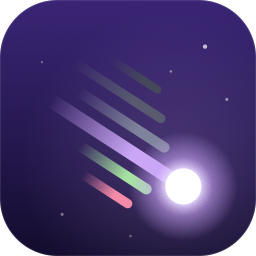

<p align="center">
  <a href="https://bisand.github.io/ctail/"></a>
</p>

<h1 align="center">ctail — color tail</h1>

<p align="center">
  <a href="https://github.com/bisand/ctail/actions/workflows/ci.yml"></a>
  <a href="https://github.com/bisand/ctail/actions/workflows/site.yml"></a>
  <a href="https://github.com/bisand/ctail/releases/latest"></a>
  <a href="LICENSE"></a>
  
</p>

<p align="center">
  <a href="https://bisand.github.io/ctail/"><b>Website</b></a> ·
  <a href="https://bisand.github.io/ctail/docs/">User guide</a> ·
  <a href="https://bisand.github.io/ctail/download/">Download</a> ·
  <a href="https://github.com/bisand/ctail/issues">Issues</a>
</p>

**ctail** is a desktop log viewer: `tail -f` with regex colour highlighting,
tabs, instant opening of multi-gigabyte files, search/filter, profiles, themes
and an optional AI assistant. The website and user guide live at
**[bisand.github.io/ctail](https://bisand.github.io/ctail/)**; their source is in [`site/`](site/).

## Repository layout

| Path | What it is |
|------|------------|
| [`core/`](core/) | **Rust engine crate** (`ctail-core`). Platform-neutral: tail engine, data model + config persistence, theme catalogue, regex highlighting, search. Exposed to Swift through [UniFFI](https://mozilla.github.io/uniffi-rs/) (`--features ffi`). |
| [`macos/`](macos/) | **Native macOS app** (Swift / AppKit) on top of `core/`. The shipping product; see [`macos/README.md`](macos/README.md). |
| [`desktop/`](desktop/) | **Linux / Windows app** on [DeniseUI](https://github.com/bisand/denise), pure Rust, `core/` as a plain dependency. Proof of concept; see [`desktop/README.md`](desktop/README.md). |
| [`site/`](site/) | Website (SvelteKit), deployed by `.github/workflows/site.yml`. |
| [`docs/`](docs/) | Feature documentation (highlighting rules, AI assistant, custom themes). |
| [`legacy/wails/`](legacy/wails/) | **Archived** original cross-platform app (Go + Svelte via Wails). Not built by CI; kept for reference. See [`legacy/wails/README.md`](legacy/wails/README.md). |

The plan: keep the UI native per platform and everything that isn't UI in
`core/`, so every front end shares one tested engine. The macOS app is there
today (what remains in Swift is AppKit, StoreKit, the sandbox bookmarks and
the AI/update HTTP clients); Linux and Windows get a DeniseUI front end that
consumes the crate directly, no FFI.

## Quick start

```bash
# Engine: tests, lint
make test-core          # cargo test -p ctail-core
make lint               # cargo fmt --check + clippy -D warnings

# Linux/Windows app (runs on macOS for development)
cargo run -p ctail-desktop -- /path/to.log

# macOS app (Swift toolchain / Xcode + Rust toolchain)
make test-macos         # builds the engine + bindings, then swift run ctailmac --selftest
make -C macos run       # build & launch
```

## Engine benchmark

`core/examples/tailbench.rs` generates a synthetic log and measures the tail
engine; `macos/scripts/tailbench/main.swift` is its twin for the Swift engine,
so both can be compared on byte-identical input.

```bash
make bench-core ARGS="--gen 2G --cold"      # Rust engine, fresh (cold) 2 GB file
make bench-core ARGS="--file /path/to.log"  # Rust engine, existing file
```

Apple-silicon internal SSD, release builds, 2026-09-03 (Rust engine called directly vs the Swift engine it replaced; through the UniFFI wrapper the index times hold, page-ins cost ~5 ms per 10 k lines — see `macos/README.md`):

| | 2 GB / 22.7 M lines | 10 GB / 113 M lines |
|---|---|---|
| First tail lines on screen | 1–7 ms (both) | 1–7 ms (both) |
| Full line index, cold cache | **0.32 s** vs 0.74 s | **1.61 s** vs 1.73 s |
| Full line index, warm cache | **0.13 s** vs 0.53 s | **0.96 s** vs 2.10 s |
| Scrollback page-in, 10 k lines | ~1 ms (both) | ~1 ms (both) |
| Engine peak RSS | 7–11 MB vs 12–13 MB | 10–11 MB vs 15–16 MB |

## License

MIT — see [LICENSE](LICENSE).
